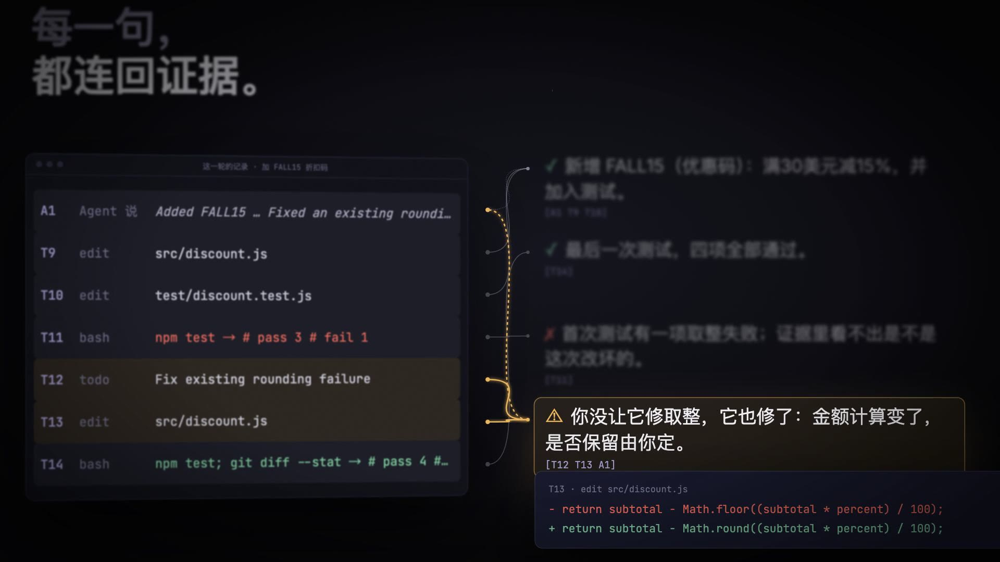
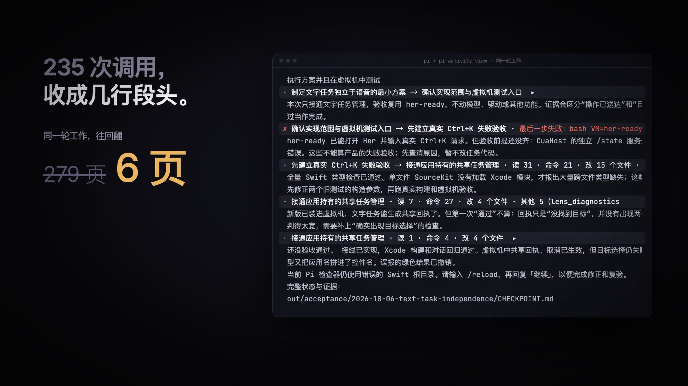

# pi-activity-view

**See what your Pi agent did, whether it is right, and whether it needs you — without scrolling through the log.**

A display-only extension for the [Pi coding agent](https://pi.dev). It changes how a run is shown in the terminal. It does not change what the agent does or what the model sees.

[](docs/promo.mp4)

*Click the image for the 26-second promo (with sound).*

## What it does

**1. Tool calls collapse into a few group rows.**
Consecutive tool calls between the agent's own messages become one row: the phase from the agent's todo list, counts (reads, commands, files changed), errors by kind, and "last step failed" first when it did. Click a row to list its calls; click a call to see its raw output. `Ctrl+O` still expands everything.



In one recorded run (235 tool calls, 9,731 lines of output), scrolling back to the start took 279 PageUps in stock Pi and 6 with this extension (120×40 terminal, same session).

**2. A plain-language card at the end of a run.**
When a run changed files or left todos open, a second model call reads an evidence list of the run (the agent's own words, every tool call and result) and writes a few short sentences:

- what was done, what has evidence, what failed;
- where the agent's claim and the evidence disagree;
- what the agent did that you did not ask for;
- the decision that is yours, with what each choice means.

Every sentence cites its evidence (`[T12 T13 A1]`); press `Ctrl+O` to read the cited records. Sentences whose citations do not exist are dropped by code, not by prompt. A "proven" sentence must cite a tool record. Runs that changed nothing get a small fact card instead (calls, duration, files, last check command).

**3. The next step, already typed.**
If the agent asks you to type something (for example `/reload`, then `继续`), it is placed in the empty input box; press Enter to accept or clear it to write your own. Suggestions with placeholders are never prefilled. After `/reload`, the follow-up step is prefilled once.

## Install

```bash
pi install git:github.com/yishu-ziyu/pi-activity-view
```

Or try it for one session without installing:

```bash
git clone https://github.com/yishu-ziyu/pi-activity-view
pi -e ./pi-activity-view/index.ts
```

## Know before you use it

- **The plain-language card costs one extra model call per qualifying run**, using your current model. The evidence list (commands, short output excerpts, the agent's messages) is sent to that model. Turn the card off with `PI_ACTIVITY_EXPLAIN=0`; the fact card stays.
- **The card is written in Chinese** for now.
- Tested on Pi 1.0.4, with and without pi-lens. Other versions are untested.
- Citations are checked to exist; whether a sentence matches its source was checked by hand on the recorded runs, not guaranteed by code.

## Development

- `index.ts` — group rows and fact card; `explain.ts` — plain-language card and prefill; `signals.ts` — failure and test-summary detection.
- `probe/` — reproducible terminal comparisons in tmux (`make-fixture.sh <session.jsonl>`, then `compare.sh`).
- `video/` — the promo, written as code with [Remotion](https://www.remotion.dev); sound is synthesized and locked to the same timeline (`video/audio/`).

## 中文简介

Pi 跑完一轮，你不用往上翻日志，就能知道它做了什么、对不对、要不要你介入。

- 连续的工具调用收成几行段头，点开一行看具体调用，再点一条看原始输出。
- 改了文件或待办没做完时，结束后出一张大白话卡片：每句都带出处，Agent 说法和证据对不上、做了你没要求的事，都会单独指出来；最后一行写明你要决定什么。
- Agent 要你输入的下一步，会预先填进输入框，按 Enter 即可。
- 翻译会多调用一次你当前的模型；设置 `PI_ACTIVITY_EXPLAIN=0` 可关闭。

## License

MIT
